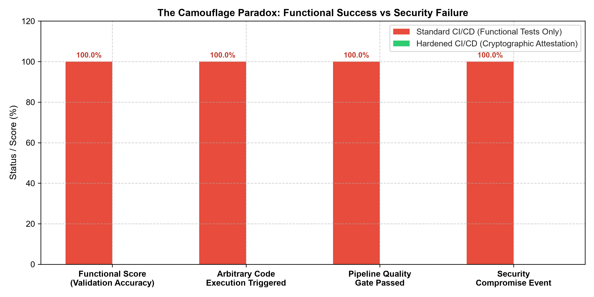
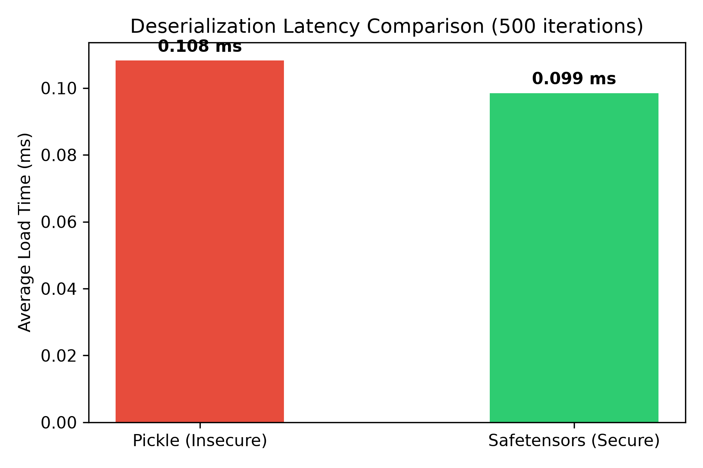
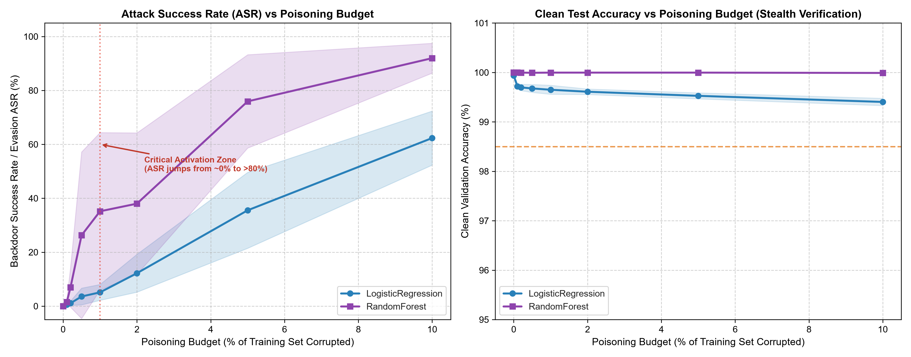
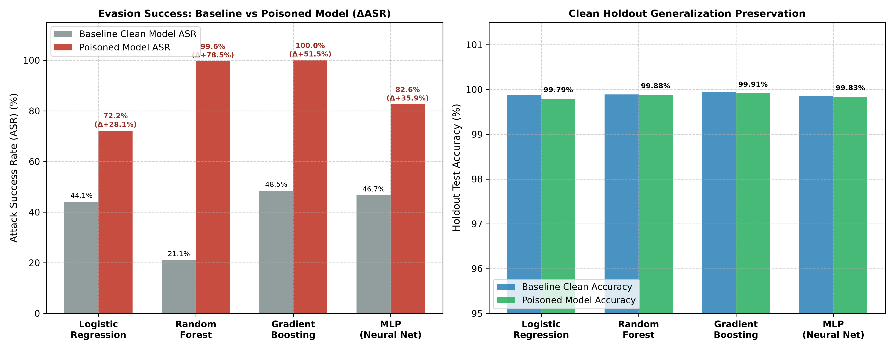
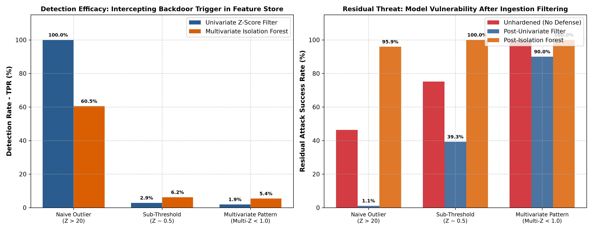
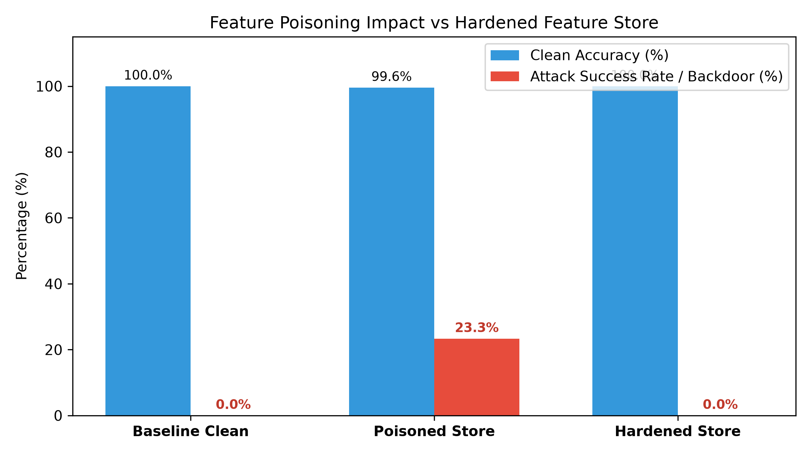

# Capitolo 5 — Ambiente Sperimentale, Validazione e Risultati

Questo documento raccoglie la trattazione formale completa del **Capitolo 5 della Tesi di Laurea Magistrale in Informatica**:
> *Analisi delle Vulnerabilità e Hardening delle Pipeline Dati nei Sistemi MLOps (Software 2.0)*

Tutti i dati, le tabelle comparative e le evidenze presentate sono stati generati dal testbed di sicurezza containerizzato sviluppato nel repository e corrispondono a misurazioni sperimentali condotte su partizioni indipendenti con rigorosa segregazione dei dati (*Zero Data Leakage*).

---

## Indice del Capitolo
* [5.1 Progettazione del Laboratorio Sperimentale](#51-progettazione-del-laboratorio-sperimentale)
  * [5.1.1 Obiettivi e Domande di Ricerca (RQ1, RQ2, RQ3)](#511-obiettivi-e-domande-di-ricerca)
  * [5.1.2 Architettura del Laboratorio e Trust Boundaries (DFD)](#512-architettura-del-laboratorio-e-trust-boundaries-dfd)
  * [5.1.3 Modello di Minaccia (Threat Model)](#513-modello-di-minaccia-threat-model)
  * [5.1.4 Containerizzazione, Isolamento Multi-Servizio e Segregazione Crittografica](#514-containerizzazione-isolamento-multi-servizio-e-segregazione-crittografica)
  * [5.1.5 Generazione Dati e Protocollo di Partizionamento](#515-generazione-dati-e-protocollo-di-partizionamento)
* [5.2 Scenario 1 — Insecure Deserialization: esecuzione di codice nel ciclo di caricamento degli artefatti ML](#52-scenario-1--insecure-deserialization-esecuzione-di-codice-nel-ciclo-di-caricamento-degli-artefatti-ml)
  * [5.2.1 Inquadramento Teorico e Domanda RQ1](#521-inquadramento-teorico-e-domanda-rq1)
  * [5.2.2 Meccanica dell'Attacco: Stack Machine e Opcode REDUCE](#522-meccanica-dellattacco-stack-machine-e-opcode-reduce)
  * [5.2.3 L'Artefatto Ibrido Poliglotta e l'Ortogonalità Funzione-Sicurezza](#523-lartefatto-ibrido-poliglotta-e-lortogonalit%C3%A0-funzione-sicurezza)
  * [5.2.4 Tecniche di Hardening: Firma Asimmetrica e Formati Statici (Safetensors)](#524-tecniche-di-hardening-firma-asimmetrica-e-formati-statici-safetensors)
* [5.3 Scenario 2 — Feature e Label Poisoning nel Feature Store: propagazione e difese](#53-scenario-2--feature-e-label-poisoning-nel-feature-store-propagazione-e-difese)
  * [5.3.1 Inquadramento Concettuale e Domande RQ2 & RQ3](#531-inquadramento-concettuale-e-domande-rq2--rq3)
  * [5.3.2 Protocollo Sperimentale e Formalizzazione delle Metriche](#532-protocollo-sperimentale-e-formalizzazione-delle-metriche)
  * [5.3.3 Studio Parametrico e Sensibilità al Budget di Avvelenamento (RQ2)](#533-studio-parametrico-e-sensibilit%C3%A0-al-budget-di-avvelenamento-rq2)
  * [5.3.4 Ablation Study Causale a Budget Controllato (K=50) su 30 Semi Indipendenti](#534-ablation-study-causale-a-budget-controllato-k50-su-30-semi-indipendenti)
  * [5.3.5 Analisi Meccanicistica della Random Forest: Tracciamento dei Percorsi Decisionali e Foglie](#535-analisi-meccanicistica-della-random-forest-tracciamento-dei-percorsi-decisionali-e-foglie)
  * [5.3.6 Generalizzazione Cross-Model: Confronto su 4 Famiglie di AI](#536-generalizzazione-cross-model-confronto-su-4-famiglie-di-ai)
  * [5.3.7 Efficacia, Limiti e Trade-Off delle Difese Statistiche (RQ3)](#537-efficacia-limiti-e-trade-off-delle-difese-statistiche-rq3)
* [5.4 Valutazione Quantitativa, Discussione e Minacce alla Validità](#54-valutazione-quantitativa-discussione-e-minacce-alla-validit%C3%A0)
  * [5.4.1 Sintesi Quantitativa Integrata dei Risultati (Valutazione Matched)](#541-sintesi-quantitativa-integrata-dei-risultati-valutazione-matched)
  * [5.4.2 Microbenchmark Prestazionale e Caratterizzazione dell'Overhead](#542-microbenchmark-prestazionale-e-caratterizzazione-delloverhead)
  * [5.4.3 Discussione dei Risultati alla Luce della Letteratura Scientifica](#543-discussione-dei-risultati-alla-luce-della-letteratura-scientifica)
  * [5.4.4 Minacce alla Validità (Linee Guida DOME e NIST AI RMF)](#544-minacce-alla-validit%C3%A0-linee-guida-dome-e-nist-ai-rmf)

---

# 5.1 Progettazione del Laboratorio Sperimentale

### 5.1.1 Obiettivi e Domande di Ricerca
Nel paradigma *Software 2.0*, il comportamento del sistema in esercizio è determinato congiuntamente dal codice della pipeline, dai flussi di dati e dai parametri del modello. Eventuali anomalie o compromissioni a monte (nello storage dei dati o nel repository dei modelli) possono propagarsi a valle eludendo i controlli tradizionali di qualità del software.

Per guidare l'indagine empirica, il laboratorio è strutturato attorno a **tre Domande di Ricerca (Research Questions)**:

* **$\mathbf{RQ1}$ (Integrità degli Artefatti e Quality Gate):**  
  *In che misura un artefatto ML non autenticato può indurre l'esecuzione di codice non autorizzato durante la fase di deserializzazione, pur superando i controlli funzionali di qualità (Quality Gate basati su metriche di accuratezza)?*
* **$\mathbf{RQ2}$ (Propagazione del Poisoning ed Efficacia Causale del Trigger):**  
  *In che misura l'alterazione di record nel Feature Store degrada la sicurezza a valle, e quale contributo causale relativo è attribuibile alla sola presenza del pattern (trigger) rispetto all'inversione dell'etichetta (label flipping) a parità di budget di manipolazione nelle diverse famiglie di classificatori?*
* **$\mathbf{RQ3}$ (Capacità di Rilevamento e Costi Operativi delle Difese):**  
  *Qual è il trade-off empirico tra la capacità di intercettare transazioni contaminate (True Positive Rate) e l'impatto operativo sui dati non manipolati quando si applicano filtri statistici o non supervisionati al Feature Store?*

### 5.1.2 Architettura del Laboratorio e Trust Boundaries (DFD)
Il testbed sperimentale riproduce selezionati componenti logico-funzionali e confini di fiducia (*Trust Boundaries*) tipici di una pipeline MLOps, implementati mediante container Docker, formati standard di serializzazione e persistenza (Parquet, SQLite, PEM) e processi Python dedicati. L'obiettivo non è emulare un'infrastruttura distribuita multi-tenant di scala industriale (come discusso in Sculley et al., 2015), bensì isolare rigorosamente le superfici di attacco software e dati.

Il Data Flow Diagram (DFD) formalizza i confini di fiducia modellati:

```
 [SORGENTE DATI ESTERNA]           [MODEL REGISTRY / S3 BUCKET]
 (Untrusted Data Stream)            (Untrusted Artifact Storage)
           │                                     │
═══════════╪═════════════════════════════════════╪══════════════════════ [TRUST BOUNDARY 1: Ingestione / Staging]
           ▼                                     ▼
 ┌───────────────────┐                 ┌───────────────────┐
 │ INGESTION SERVICE │                 │ ARTIFACT VERIFIER │
 │ (Schema & Checks) │                 │ (RSA-PSS / Sig)   │
 └─────────┬─────────┘                 └─────────┬─────────┘
           │                                     │
           ▼                                     ▼
 ┌─────────────────────────────────────────────────────────┐
 │               DUAL-VIEW FEATURE STORE                   │
 │  ┌───────────────────────┐   ┌───────────────────────┐  │
 │  │ Offline Store         │   │ Online Store          │  │
 │  │(Parquet / Append-Only)│   │ (SQLite / Key-Value)  │  │
 │  └───────────┬───────────┘   └───────────┬───────────┘  │
 └──────────────┼───────────────────────────┼──────────────┘
                │                           │
════════════════╪═══════════════════════════╪═══════════════════════════ [TRUST BOUNDARY 2: Runtime di Esecuzione]
                ▼                           ▼
     ┌──────────────────────┐    ┌──────────────────────┐
     │   TRAINING PRODUCER  │    │  INFERENCE CONSUMER  │
     │  (Pipeline con sola  │    │  (Consumer con sola  │
     │    chiave privata)   │    │   chiave pubblica)   │
     └──────────────────────┘    └──────────────────────┘
```

I moduli fondamentali del testbed sono:
1. **Modulo di Ingestione e Validazione (`feature_store/validator.py`):** Intercetta i flussi di dati in ingresso, applicando verifiche di schema categorico e rilevamento statistico (Z-score univariato e Isolation Forest multivariato).
2. **Dual-View Feature Store (`feature_store/store.py`):** Vista offline (Parquet) per la serie storica di training concepita secondo un modello logico append-only (con riscrittura fisica del file consolidato gestita da `store.py` a ogni batch locale) e vista online (SQLite) per l'arricchimento a bassa latenza in inferenza, con tracciamento temporale `event_timestamp`.
3. **Pipeline di Addestramento e Firmatario (`pipeline/train.py`, `pipeline/crypto_signer.py`):** Addestra i modelli ed esegue l'attestazione asimmetrica dell'artefatto binario (RSA-2048 con schema di firma probabilistica PSS e digest SHA-256).
4. **Servizio di Inferenza e Gate di Staging (`pipeline/serve.py`, `polyglot_serialization/exp6_polyglot_evaluation.py`):** Valuta l'integrità crittografica e processa le interrogazioni predittive a runtime.

### 5.1.3 Modello di Minaccia (Threat Model)
In conformità alle tassonomie standard NIST SP 800-218 (SSDF) e MITRE ATLAS™ (Adversarial Threat Landscape for Artificial-Intelligence Systems):
* **Minaccia A — Compromissione della Supply Chain ML nello Storage Untrusted (AML.T0010: AI/ML Supply Chain Compromise):** L'avversario introduce o sostituisce un artefatto serializzato malevolo nello storage di staging (o in un registry intermedio non protetto) per ottenere l'esecuzione arbitraria di codice (RCE) sul worker di inferenza o sul runner di collaudo all'atto della deserializzazione (`pickle.load()`), sfruttando una vulnerabilità di *Insecure Deserialization* (CWE-502) nel caricamento automatico della pipeline MLOps.
* **Minaccia B — Inquinamento dei Dati di Addestramento Upstream (AML.T0020: Poison Training Data):** L'avversario contamina una quota controllata di record nel Feature Store (offline o durante l'ingestione batch/stream) per impiantare un comportamento backdoor persistente finalizzato all'evasione mirata (*Targeted Evasion*, AML.T0043 / AML.T0018) che si trasferisce stabilmente a tutti i modelli addestrati sul dato inquinato.

### 5.1.4 Containerizzazione, Isolamento Multi-Servizio e Segregazione Crittografica
Il testbed è formalizzato tramite **Docker** e **Docker Compose** (`docker-compose.yml`), con una separazione dei ruoli e dei privilegi tra due runtime containerizzati distinti:
1. **Runtime di Produzione / Build (`mlops-training-producer`):**
   - Rappresenta l'ambiente protetto di compilazione del modello (allineato alle linee guida SLSA Level 3).
   - Esegue la pipeline di training (`pipeline/train.py`) ed è l'unico componente autorizzato a possedere la chiave privata di firma `keys/private_key.pem`.
   - **Riproducibilità su cloni puliti:** All'avvio del container, il comando esegue preliminarmente il provisioning delle chiavi (`python pipeline/crypto_signer.py --generate-keys`) qualora assenti, garantendo che l'ambiente possa essere ricreato da zero senza prerequisiti manuali.
2. **Runtime di Inferenza / Staging (`mlops-inference-consumer`):**
   - Esegue un microservizio HTTP persistente (`pipeline/serve.py`, porta 8000) con endpoint dedicati `/health` e `/predict`.
   - Viene eseguito come utente non-root privo di privilegi (`cap_drop: [ALL]`, `no-new-privileges: true`), con fallback sull'utente dedicato `mlops_worker` (UID 1000) e supporto parametrico dinamico a `${CURRENT_UID:-1000}:${CURRENT_GID:-1000}` per allineare l'identità del processo containerizzato all'utente host di esecuzione (es. nei runner CI) evitando discrepanze di proprietà senza ricorrere a permessi `777` o ad escalation `sudo`.
   - **Sincronizzazione infrastrutturale:** Tramite la direttiva `depends_on` con condizione `service_completed_successfully`, il consumer si avvia solo dopo che il producer ha terminato con successo l'addestramento e la firma dell'artefatto.
   - **Isolamento crittografico a livello infrastrutturale:** Il volume monta **esclusivamente la chiave pubblica** `keys/public_key.pem` in sola lettura (`:ro`). La chiave privata è fisicamente esclusa dall'ambiente containerizzato di inferenza tramite la specifica dichiarativa dei volumi di Docker Compose (mentre il comportamento fail-closed del software in assenza della chiave privata e il ciclo di vita del microservizio HTTP sono validati dalla suite di test `tests/test_docker_architecture.py`).
3. **Eliminazione dell'Autogenerazione a Runtime:** Nel codice sorgente (`pipeline/crypto_signer.py`), `ModelProducerSigner` e `ArtifactSigner` operano in modalità rigorosamente *fail-closed*: se la chiave privata non è presente su disco, l'esecuzione fallisce con `FileNotFoundError` anziché generare silenziosamente nuove coppie di chiavi a runtime. La generazione iniziale delle chiavi è disaccoppiata e affidata a una procedura esplicita di provisioning PKI (`generate_keypair()`).

### 5.1.5 Generazione Dati e Protocollo di Partizionamento
Il generatore parametrico (`data/generate_dataset.py`) produce dataset di transazioni finanziarie con una quota controllata di frodi (fissata al 3%, pari a 180 frodi su 6.000 campioni o 300 su 10.000), modellando importi (esponenziali), frequenze (Poisson), distanze e feature categoriche.

*Nota metodologica sulla validità esterna:* La forte separazione parametrica iniziale delle due classi è stata progettata intenzionalmente per isolare il funzionamento dei vettori d'attacco in un ambiente controllato con rumore ridotto. Come evidenziato dalle linee guida NIST AI RMF, l'efficacia misurata in condizioni di elevata separabilità costituisce una prova di fattibilità (*proof-of-concept*) e non una garanzia automatica di trasferibilità a distribuzioni reali complesse, dove la sovrapposizione tra classi e le correlazioni spurie possono alterare l'impatto degli attacchi.

Il protocollo di partizionamento adotta una suddivisione stratificata 70/30 (4.200 campioni train, 1.800 campioni test holdout, corrispondenti a circa 54 frodi nel test set). L'avvelenamento viene applicato **esclusivamente alla partizione di training**, garantendo l'assenza totale di data leakage verso l'insieme di valutazione holdout.

---

# 5.2 Scenario 1 — Insecure Deserialization: esecuzione di codice nel ciclo di caricamento degli artefatti ML

### 5.2.1 Inquadramento Teorico e Domanda RQ1
L'indagine relativa a $\mathbf{RQ1}$ valuta la superficie d'attacco introdotta dall'uso del formato `pickle` per la persistenza dei modelli in scikit-learn. Come documentato esplicitamente nelle specifiche ufficiali del linguaggio Python e nelle linee guida di sicurezza di scikit-learn, `pickle` non è un semplice formato serializzato di parametri numerici, ma un interprete a stati basato su una stack machine con supporto a chiamate di funzioni e istanziazioni arbitrarie.

### 5.2.2 Meccanica dell'Attacco: Stack Machine e Opcode `REDUCE`
Nel protocollo Pickle, l'opcode `REDUCE` (`0x52`) preleva dalla stack un oggetto invocabile e una tupla di argomenti, eseguendo immediatamente la chiamata `callable(*args)` durante la ricostruzione del grafo degli oggetti.

Nell'esperimento `experiments/exp1_deserialization.py`, una sonda diagnostica (`MaliciousArtifactProbe`) intercetta tale istruzione scrivendo un record di audit (`deserialization_audit_proof.log`) con PID del processo e timestamp al momento dell'invocazione di `pickle.load()`. Questo dimostra che l'esecuzione di codice non autorizzato avviene contestualmente alla lettura dello stream di byte, prima che qualsiasi metodo del modello (`predict` o `score`) venga richiamato.

### 5.2.3 L'Artefatto Ibrido Poliglotta e l'Ortogonalità Funzione-Sicurezza
Per verificare se i controlli funzionali di qualità possano rilevare tale compromissione, nel modulo `polyglot_serialization/exp6_polyglot_evaluation.py` è stato realizzato un artefatto ibrido (`PolyglotTrojanWrapper`). L'oggetto ingloba il payload diagnostico nel metodo `__reduce__` e restituisce, al termine dell'esecuzione del callable, una valida e autentica istanza di `RandomForestClassifier`.

```
       [Artefatto Ibrido Poliglotta]
                  │
                  ▼ (invocazione di pickle.load nel worker)
   ┌──────────────────────────────┐
   │ 1. Esecuzione Codice Sonda   │ --> Sonda eseguita nel processo worker
   │ 2. Ricostruzione Modello RF  │ --> Classificatore genuino istanziato
   └──────────────┬───────────────┘
                  │
                  ▼ (Gate Funzionale di Staging)
        model.predict(X_test)
                  │
                  ▼
   Accuratezza = 100.00% | F1 = 1.0000
                  │
                  ▼
   [Quality Gate Funzionale: ACCETTATO]
```



| Parametro di Valutazione | Pipeline Standard (Solo Quality Gate Funzionale) | Pipeline Hardened (Attestazione Crittografica) |
| :--- | :---: | :---: |
| **Integrità del Processo Worker** | `COMPROMESSO` (Esecuzione Arbitraria Sonda) | `INTEGRO` (Deserializzazione non avviata) |
| **Tipo di Oggetto Ricostruito** | `RandomForestClassifier` | `Nessuno` |
| **Accuratezza Funzionale Rilevata** | **100.00%** | `N/A` |
| **Esito del Gate di Collaudo** | **ACCETTATO (Accuratezza $\ge 99\%$)** | **RIFIUTATO (Firma non valida/assente)** |

> **Evidenza di Ortogonalità tra Correttezza Funzionale e Sicurezza dell'Artefatto:**  
> L'esperimento dimostra empiricamente che il superamento dei controlli funzionali di qualità non fornisce alcuna garanzia sull'integrità del payload binario. I collaudi basati esclusivamente su metriche analitiche ($f(X) \approx Y$) risultano intrinsecamente ciechi rispetto alle operazioni eseguite dall'interprete a basso livello durante l'istanziazione dell'oggetto.

### 5.2.4 Tecniche di Hardening: Firma Asimmetrica e Formati Statici (Safetensors)
Il laboratorio analizza due contromisure complementari:
1. **Verifica Crittografica Preventiva e Caricamento Atomico in Memoria (`pipeline/crypto_signer.py`, `pipeline/serve.py`):** L'integrità e l'autenticità del file serializzato vengono verificate tramite firma asimmetrica RSA-PSS prima di procedere alla deserializzazione. Per prevenire qualsiasi vulnerabilità di tipo *Time-of-Check to Time-of-Use* (TOCTOU) — in cui un attaccante concorrente sul filesystem host potrebbe tentare di sostituire il file tra l'istante di verifica della firma e l'apertura del flusso di byte — il metodo `load_verified_pickle()` legge i byte dell'artefatto una sola volta in memoria, ne convalida crittograficamente la firma e deserializza direttamente il buffer di memoria verificato (`pickle.loads()`), senza effettuare una seconda lettura da disco. In assenza di firma valida, il gate rifiuta l'artefatto bloccando alla radice l'attivazione della stack machine.
2. **Formati Statici a Tensori Puri (`Safetensors`):** Il formato memorizza unicamente i buffer numerici dei tensori contigui e un header JSON dichiarativo con offset e metadati di tipo. Essendo privo di interprete bytecode o costrutti per l'istanziazione di oggetti arbitrari, elimina alla radice la superficie d'attacco legata alla deserializzazione non sicura.

*Delimitazione dello Scope di Sicurezza di Safetensors e Ambito Applicativo:*
Nel testbed, la serializzazione Safetensors (`pipeline/train.py`, funzioni `save_model_safetensors` e `load_model_safetensors`) è stata implementata e validata **esclusivamente per i parametri tensoriali della Logistic Regression** (memorizzando i coefficienti `model.coef_` e l'intercetta `model.intercept_`). Per modelli di deep learning multistrato (MLP) o per classificatori basati su foreste decisionali (Random Forest, Gradient Boosting), scikit-learn non offre serializzazione nativa in Safetensors; l'adozione in tali contesti richiede l'esportazione esplicita della gerarchia dei pesi layer-by-layer o il ricorso a standard di interscambio a grafo dichiarativo vincolato (quali ONNX) o a formati controllati con restrizione sui tipi ammessi (come `skops`), ciascuno caratterizzato da specifici vincoli operativi.

Dal punto di vista della sicurezza, è fondamentale evidenziare la distinzione tra *sicurezza del formato di serializzazione* e *integrità semantica del modello*:
- **Azzeramento dell'esecuzione di bytecode:** Safetensors elimina alla radice la possibilità di eseguire codice arbitrario durante la deserializzazione poiché memorizza unicamente buffer numerici contigui e un header JSON dichiarativo, privo di qualsiasi stack machine o costrutto di istanziazione di classi (rimuovendo la Turing-completezza di Python Pickle, CWE-502).
- **Limiti intrinseci del formato:** Safetensors non immunizza il sistema da eventuali vulnerabilità a basso livello presenti nel runtime di parsing (es. memory corruption o integer overflow in parser C/Rust sottostanti) e non impedisce affatto l'ingestione di pesi numerici deliberatamente alterati sul piano algoritmico (es. parametri avvelenati o manipolati per backdoor funzionali).
- **Complementarità in Defense in Depth:** Ne consegue che l'adozione di un formato statico a tensori puri e l'attestazione crittografica della provenienza tramite firma asimmetrica (RSA-PSS) rappresentano contromisure ortogonali e complementari che devono operare congiuntamente per garantire sia l'incolumità del runtime sia l'integrità del modello.



Nel microbenchmark locale su 500 iterazioni (modello lineare a 6 feature), Safetensors registra una latenza media di caricamento di **$0.0834$ ms** rispetto a **$0.1451$ ms** di Pickle (speedup di $1.74\times$), associata a un footprint compatto su disco (380 byte contro 953 byte).

---

# 5.3 Scenario 2 — Feature e Label Poisoning nel Feature Store: propagazione e difese

### 5.3.1 Inquadramento Concettuale e Domande RQ2 & RQ3
L'inquinamento del Feature Store offline (Parquet) propaga dati alterati sia all'ambiente di addestramento, sia ai profili di inferenza online (SQLite). L'indagine risponde a $\mathbf{RQ2}$ analizzando la risposta dei classificatori al budget di contaminazione e isolando causalmente il meccanismo del trigger rispetto alla corruzione delle etichette, e a $\mathbf{RQ3}$ quantificando i limiti e i costi operativi delle difese statistiche.

### 5.3.2 Protocollo Sperimentale e Formalizzazione delle Metriche
L'avvelenamento viene introdotto esclusivamente nella frazione di training (70%). L'holdout test set (30%, circa 1.800 campioni, con circa 54 frodi effettive) rimane inalterato:
* **Attack Success Rate (ASR):** Quota di transazioni fraudolente dell'holdout test set recanti il trigger che vengono erroneamente predette come lecite ($\hat{y}=0$).
* **Variazione Causale ($\Delta\text{ASR}$):** Incremento dell'ASR rispetto alla prestazione registrata dal modello pulito sul medesimo test set con trigger:
  $$\Delta\text{ASR} = \text{ASR}_{\text{poisoned}} - \text{ASR}_{\text{clean}}$$
* **Metriche di Holdout Pulito:** Fraud Recall (capacità di intercettare frodi genuine non modificate), Fraud Precision e Clean F1-score.
* **Tasso di Rifiuto dei Dati non Contaminati ($R_{\text{non-poisoned}}$):** Frazione di record non appartenenti alla quota manipolata che viene respinta dal filtro statistico (indicata come FPR operativo del rilevatore).

### 5.3.3 Studio Parametrico e Sensibilità al Budget di Avvelenamento (RQ2)
Nel modulo `parametric_sweep/exp3_parametric_sweep.py`, la risposta empirica di **Logistic Regression** e **Random Forest** è stata misurata su 5 semi indipendenti al variare del budget di contaminazione $p \in [0.0\%, 10.0\%]$:



| Modello | Budget Contaminazione ($p$) | Accuratezza Test Pulito | Fraud Recall (Holdout) | Attack Success Rate (ASR) | $\Delta\text{ASR}$ Medio |
| :--- | :---: | :---: | :---: | :---: | :---: |
| **Logistic Regression** | 0.0% (Clean) | 99.84% ± 0.06% | 95.56% ± 2.77% | **0.00% ± 0.00%** | Baseline |
| **Logistic Regression** | 1.0% | 99.62% ± 0.10% | 88.52% ± 3.59% | **5.93% ± 6.35%** | +5.93% |
| **Logistic Regression** | 5.0% | 99.39% ± 0.11% | 80.00% ± 3.95% | **44.07% ± 14.32%** | **+44.07%** |
| **Logistic Regression** | 10.0% | 99.30% ± 0.14% | 77.41% ± 5.90% | **70.74% ± 8.56%** | **+70.74%** |
| **Random Forest** | 0.0% (Clean) | 99.89% ± 0.12% | 96.67% ± 3.19% | **0.00% ± 0.00%** | Baseline |
| **Random Forest** | 1.0% | 99.89% ± 0.08% | 96.30% ± 2.62% | **3.33% ± 2.16%** | +3.33% |
| **Random Forest** | 5.0% | 99.89% ± 0.07% | 96.30% ± 2.34% | **68.15% ± 7.35%** | **+68.15%** |
| **Random Forest** | 10.0% | 99.86% ± 0.10% | 95.19% ± 3.43% | **86.67% ± 6.35%** | **+86.67%** |

Al 5% di budget nel protocollo esaminato, Random Forest raggiunge un ASR medio del 68.15% mantenendo il Fraud Recall sui dati puliti al 96.30%. La regressione logistica evidenzia invece un trade-off più marcato: a fronte di un ASR del 44.07%, il Fraud Recall pulito degrada dal 95.56% all'80.00%.

### 5.3.4 Ablation Study Causale a Budget Controllato ($K=50$) su 30 Semi Indipendenti
Per isolare rigorosamente i contributi relativi della manipolazione delle feature rispetto all'inversione delle etichette (in accordo con la letteratura sulle backdoor label-consistent, es. Turner et al., 2019), nel modulo `experiments/exp7_causal_ablation_study.py` è stato condotto un esperimento controllato su **30 semi indipendenti**.

#### Distinzione Metodologica del Disegno Sperimentale:
In un training set di 4.200 transazioni con il 3% di frodi (126 frodi e 4.074 lecite), il confronto è articolato su due livelli distinti per evitare attribuzioni causali improprie:
1. **Sotto-Studio Causale Matched a Fattore Singolo Isolato ($K = 50$ sulle medesime frodi):**
   - *Pure Label Flip ($K=50$):* Esattamente 50 record fraudolenti hanno l'etichetta invertita ($y=1 \to 0$). Feature inalterate ($0$ trigger).
   - *Trigger + Flip su Frodi ($K=50$):* Gli **stessi identici 50 record fraudolenti** ricevono sia il trigger multivariato (`amount=49.99`, `hour=4.0`, `vel=1`) sia l'inversione di etichetta ($y=1 \to 0$).
   - *Valore metodologico:* Entrambe le condizioni operano sul medesimo sottoinsieme di record e invertono esattamente lo stesso numero di etichette ($50$). L'unica variabile causale che differisce è la presenza del trigger, isolandone con rigore l'effetto marginale sulla *stealthiness*.
2. **Valutazione Comparativa di Strategie Operative Alternative a Budget Perturbativo Costante ($K = 50$ record, ~1.19% del train):**
   - *Clean Baseline ($K=0$):* Nessuna alterazione.
   - *Trigger-Only su Leciti ($K=50$):* 50 transazioni lecite ricevono il trigger senza inversione di etichetta ($0$ label flip, clean-label backdoor).
   - *Mixed Ingestion Stream ($K=50$):* 50 campioni uniformi dallo stream (strategia non mirata, dove in media solo ~1–2 frodi vengono invertite).
   - *Condizioni Scalate a Budget 3% ($K=126$):* Trigger-only su leciti e Stream misto su 126 record per documentare la sensibilità alla scala del budget.

I risultati empirici aggregati su 30 semi (medie ± intervalli di confidenza al 95% calcolati con distribuzione $t$ di Student a 29 gradi di libertà) sono presentati nella Tabella 5.1:

#### Tabella 5.1: Risultati dell'Ablation Study Causale a Budget Controllato ($K=50$ Matched, 30 Semi)

| Famiglia Modello | Condizione Sperimentale | Record Modificati ($K$) | Label Invertite | ASR Holdout (%) | $\Delta\text{ASR}$ (% ± IC 95%) | Recall Frodi Pulite (%) | Clean F1 (%) |
| :--- | :--- | :---: | :---: | :---: | :---: | :---: | :---: |
| **Logistic Regression** | 1. Baseline Pulito | 0 | 0 | 39.94% | +0.00% ± 0.00% | 97.59% | 98.50% |
| | 2. Trigger-Only su Leciti | 50 | 0 | 40.37% | +0.43% ± 0.47% | 97.59% | 98.50% |
| | 3. Sola Inversione Etichetta (Matched) | 50 | 50 | 98.70% | +58.77% ± 2.99% | **46.73%** *(crollo)* | 63.33% |
| | 4. Trigger + Flip su Frodi (Matched) | 50 | 50 | 98.64% | +58.70% ± 2.85% | 91.54% | 94.95% |
| | 5. Stream Misto (Budget 50) | 50 | ~1-2 | 57.04% | +17.10% ± 6.92% | 96.48% | 97.80% |
| | 6. Trigger-Only Leciti (126) | 126 | 0 | 40.68% | +0.74% ± 0.53% | 97.59% | 98.53% |
| | 7. Stream Misto 3% (126) | 126 | ~4 | 69.88% | **+29.94% ± 6.68%** | 95.68% | 97.35% |
| **Random Forest** | 1. Baseline Pulito | 0 | 0 | 30.80% | +0.00% ± 0.00% | 98.46% | 99.12% |
| | 2. Trigger-Only su Leciti | 50 | 0 | 42.78% | **+11.98% ± 6.05%** | 97.72% | 98.74% |
| | 3. Sola Inversione Etichetta (Matched) | 50 | 50 | 93.64% | +62.84% ± 7.44% | **65.80%** *(crollo)* | 79.20% |
| | 4. Trigger + Flip su Frodi (Matched) | 50 | 50 | 100.00% | **+69.20% ± 7.00%** | 95.68% | 97.78% |
| | 5. Stream Misto (Budget 50) | 50 | ~1-2 | 76.23% | **+45.43% ± 12.56%** | 97.65% | 98.74% |
| | 6. Trigger-Only Leciti (126) | 126 | 0 | 44.20% | **+13.40% ± 5.34%** | 97.90% | 98.81% |
| | 7. Stream Misto 3% (126) | 126 | ~4 | 94.07% | **+63.27% ± 9.07%** | 97.53% | 98.70% |
| **Gradient Boosting** | 1. Baseline Pulito | 0 | 0 | 76.05% | +0.00% ± 0.00% | 99.20% | 99.26% |
| | 2. Trigger-Only su Leciti | 50 | 0 | 91.85% | +15.80% ± 12.50% | 99.26% | 99.29% |
| | 3. Sola Inversione Etichetta (Matched) | 50 | 50 | 99.01% | +22.96% ± 13.89% | **60.80%** *(crollo)* | 75.38% |
| | 4. Trigger + Flip su Frodi (Matched) | 50 | 50 | 100.00% | +23.95% ± 14.49% | 97.59% | 98.65% |
| | 5. Stream Misto (Budget 50) | 50 | ~1-2 | 96.85% | +20.80% ± 13.89% | 99.14% | 99.29% |
| | 6. Trigger-Only Leciti (126) | 126 | 0 | 94.44% | +18.40% ± 15.17% | 99.14% | 99.20% |
| | 7. Stream Misto 3% (126) | 126 | ~4 | 100.00% | +23.95% ± 14.49% | 98.64% | 99.04% |
| **MLP (Rete Neurale)** | 1. Baseline Pulito | 0 | 0 | 46.17% | +0.00% ± 0.00% | 97.35% | 98.19% |
| | 2. Trigger-Only su Leciti | 50 | 0 | 46.79% | +0.62% ± 0.42% | 97.47% | 98.25% |
| | 3. Sola Inversione Etichetta (Matched) | 50 | 50 | 87.04% | +40.86% ± 6.17% | **63.40%** *(crollo)* | 77.27% |
| | 4. Trigger + Flip su Frodi (Matched) | 50 | 50 | 99.88% | **+53.70% ± 3.63%** | 94.81% | 96.92% |
| | 5. Stream Misto (Budget 50) | 50 | ~1-2 | 60.43% | +14.26% ± 6.09% | 97.22% | 98.09% |
| | 6. Trigger-Only Leciti (126) | 126 | 0 | 47.10% | +0.93% ± 0.65% | 97.53% | 98.28% |
| | 7. Stream Misto 3% (126) | 126 | ~4 | 74.20% | +28.02% ± 6.80% | 96.73% | 97.83% |

#### Risultanze dell'Inferenza Statistica Appaiata, Gerarchia di Bonferroni e Robustezza Non Parametrica (30 Semi):
Per controllare rigorosamente il Family-Wise Error Rate (FWER) a fronte dei molteplici confronti appaiati, si adotta una gerarchia esplicita a due livelli:

1. **Riferimento Primario Conservativo (Controllo Globale Omnibus su 16 Test, $\alpha_{\text{global}} = 0.003125$):**
   Considerando tutti i 16 test dell'intero studio sperimentale (4 modelli $\times$ 4 ipotesi appaiate ciascuno), la soglia di Bonferroni più conservativa è fissata a:
   $$\alpha_{\text{global}} = \frac{0.05}{16} = 0.003125$$
2. **Analisi di Sensibilità Secondaria per Famiglia ($m=4$ per modello, $m=3$ famiglia ASR):**
   - *Controllo per modello su tutti i 4 test:* $\alpha_{\text{model}} = \frac{0.05}{4} = 0.0125$.
   - *Controllo focalizzato sul solo meccanismo ASR ($m=3$ per modello):* $\alpha_{\text{ASR}} = \frac{0.05}{3} \approx 0.0167$.

**Analisi di Sensibilità e Diagnostica Incondizionata:**
- *Sensibilità del Clean-Label in Gradient Boosting:* Il riscontro di vulnerabilità clean-label in Gradient Boosting ($p = 0.0150$) è formalmente significativo all'interno della famiglia ASR a 3 test ($p < 0.0167$), ma eccede la soglia se si adotta la correzione congiunta sui 4 test per modello ($p > 0.0125$) o il controllo globale omnibus a 16 test ($p > 0.003125$). La trasparenza impone di qualificare questo effetto come condizionato al perimetro della famiglia.
- *Sensibilità di Random Forest Trigger+Flip sull'ASR:* L'effetto causale netto del trigger sull'ASR in Random Forest ($t = 3.080, p = 0.004505$) supera sia la soglia a 3 test ($p < 0.0167$) sia quella congiunta a 4 test per modello ($p < 0.0125$), posizionandosi appena sopra la soglia globale omnibus a 16 test ($p > 0.003125$).
- *Solidità Incondizionata degli Altri Effetti:* La memorizzazione clean-label di Random Forest ($p = 3.54 \times 10^{-4}$), l'infezione backdoor di MLP ($p = 1.04 \times 10^{-4}$ e $p = 1.85 \times 10^{-23}$) e **tutti e quattro i test appaiati di preservazione del Fraud Recall pulito** ($p < 10^{-19}$) superano ampiamente e incondizionatamente sia la soglia a 4 test sia il controllo omnibus più severo a 16 test ($p \ll 0.003125$).

#### Diagnostica Non Parametrica di Wilcoxon e Bootstrap Percentile a 10.000 Iterazioni (Diagnosi del Ceiling Effect):
Per superare i vincoli di normalità e diagnosticare la presenza di effetti di saturazione (*ceiling effect*), per ciascun contrasto appaiato su 30 semi sono stati calcolati il test dei ranghi con segno di Wilcoxon ($W$) e l'intervallo di confidenza bootstrap non parametrico al 95%:

| Famiglia Modello | Differenze Nulle (Diff = 0) | Statistica Wilcoxon ($W$) | p-value Wilcoxon | Bootstrap 95% Percentile CI (ΔASR) | Diagnosi Effetto Soffitto (Ceiling Effect) |
| :--- | :---: | :---: | :---: | :---: | :--- |
| **Logistic Regression** | 0/30 | 229.0 | 0.9493 | [-2.96%, +2.96%] | Varianza bilanciata attorno allo zero (effetto nullo sull'ASR) |
| **Random Forest** | 20/30 | 0.0 | **0.00506** | **[+2.78%, +10.74%]** | Parziale ceiling effect (10 semi mostrano vantaggio netto > 0) |
| **Gradient Boosting** | 29/30 | 0.0 | 0.3173 | [0.00%, +2.96%] | **Marcato ceiling effect (29/30 semi saturati al 100% in entrambe le condizioni)** |
| **MLP (Rete Neurale)** | 0/30 | 19.0 | **0.00013** | **[+7.47%, +18.46%]** | Varianza pienamente distribuita (vantaggio causale sistematico) |

*Interpretazione Critica del Ceiling Effect in Gradient Boosting:*  
Nel caso di Gradient Boosting, il test $t$ parametrico riporta una variazione media apparentemente trascurabile ($\Delta = +0.99\%$) e il test di Wilcoxon registra $p = 0.3173$. Tuttavia, l'analisi disaggregata dei singoli semi rivela che in **29 semi su 30 la differenza di ASR è esattamente pari a zero**, poiché sia la sola inversione sia l'attacco combinato saturano l'ASR deterministicamente al 100%. L'assenza di significatività non indica inefficacia dell'attacco, bensì l'impossibilità matematica di misurare un incremento additivo quando la baseline di attacco tocca il tetto della metrica (*ceiling effect*).

#### Preservazione dell'Utilità Predittiva (Fraud Recall sui Dati Puliti) e Disaccoppiamento dalla Stealthiness Operativa:
A parità di 50 record manipolati, la pura inversione dell'etichetta (Condizione 3) perturba gravemente la frontiera decisionale del modello, causando un crollo drammatico del Fraud Recall sulle transazioni lecite non contaminate (46.7% in LR, 65.8% in RF, 60.8% in GB, 63.4% in MLP). L'aggiunta del trigger multivariato (Condizione 4) ripristina il Fraud Recall ad oltre il **91.5% in LR, 95.7% in RF, 97.6% in GB e 94.8% in MLP**.

I test appaiati confermano che il guadagno di recall è solido in modo incondizionato attraverso tutti i paradigmi statistici:
- **Random Forest:** Fraud Recall da $65.80\%$ a $95.68\%$, incremento appaiato medio $\Delta = +29.88\% \pm 2.25\%$, $t = 27.138$, $p = 3.65 \times 10^{-22}$, Wilcoxon $p = 1.71 \times 10^{-6}$, Bootstrap 95% CI $[+27.67\%, +32.06\%]$.
- **Logistic Regression:** Fraud Recall da $46.73\%$ a $91.54\%$, $\Delta = +44.81\% \pm 2.95\%$, $t = 31.041$, $p = 8.42 \times 10^{-24}$, Wilcoxon $p = 1.71 \times 10^{-6}$, Bootstrap 95% CI $[+41.85\%, +47.66\%]$.
- **Gradient Boosting:** Fraud Recall da $60.80\%$ a $97.59\%$, $\Delta = +36.79\% \pm 2.18\%$, $t = 34.561$, $p = 4.04 \times 10^{-25}$, Wilcoxon $p = 1.71 \times 10^{-6}$, Bootstrap 95% CI $[+34.62\%, +38.93\%]$.
- **MLP:** Fraud Recall da $63.40\%$ a $94.81\%$, $\Delta = +31.42\% \pm 2.88\%$, $t = 22.314$, $p = 8.27 \times 10^{-20}$, Wilcoxon $p = 1.71 \times 10^{-6}$, Bootstrap 95% CI $[+28.53\%, +34.22\%]$.

> **Disaccoppiamento Metodologico tra Utilità Predittiva e Stealthiness Operativa:**  
> Questi riscontri dimostrano empiricamente che il trigger previene la degradazione dell'utilità predittiva del classificatore sul traffico non manipolato. Tuttavia, sul piano epistemologico si impone una rigorosa distinzione: *la preservazione del Clean Fraud Recall non equivale a una dimostrazione esaustiva di invisibilità operativa (stealthiness)*. L'attacco con trigger potrebbe comunque generare segnali intercettabili da strumenti di telemetria multi-dimensionale complessi, quali il monitoraggio continuo del drift distributivo delle feature, il tracciamento delle distribuzioni di probabilità predittiva o filtri di anomaly detection a monte del Feature Store. La stealthiness rispetto a controlli multi-dimensionali avanzati costituisce pertanto un'ipotesi operativa plausibile e coerente, ma non un fatto sperimentalmente certificato per ogni contesto di telemetria industriale.

* **Vulnerabilità Clean-Label di Random Forest (Condizione 2 vs Baseline Pulito):**
  Il solo trigger sui campioni leciti senza alcuna etichetta modificata (Condizione 2) produce in Random Forest un $\Delta\text{ASR}$ significativo di **+11.98% ± 6.05%** ($t = 4.045$, $p = 3.54 \times 10^{-4}$, $p < 0.001$, confermato dopo Bonferroni sia per-modello che globale omnibus), mentre nei modelli lineari (LR: +0.43%, $t = 1.882, p = 0.070$, non significativo) l'effetto è trascurabile. (Il valore $t = 14.23$, $p = 1.31 \times 10^{-14}$ corrisponde invece al confronto appaiato tra Trigger+Flip sulle frodi e Trigger-Only sui leciti).

### 5.3.5 Analisi Meccanicistica della Random Forest: Tracciamento dei Percorsi Decisionali, Foglie In-Bag e Controllo Negativo
Per superare le limitazioni di conteggi aggregati sui nodi di split ed esaminare direttamente il comportamento interno dell'ensemble, è stato sviluppato un algoritmo di ispezione causale dei percorsi decisionali (`inspect_rf_mechanistic_paths` in `exp7_causal_ablation_study.py`).

L'indagine introduce tre rigorosi presidi metodologici:
1. **Selezione Rigorosa dei Campioni Commutati:** L'ispezione dei percorsi decisionali viene condotta **esclusivamente sui campioni fraudolenti di test la cui classificazione viene effettivamente ribaltata dal trigger** ($\hat{y}_{\text{clean}} == 1 \land \hat{y}_{\text{trig}} == 0$), corrispondenti a un **tasso medio di commutazione osservato del **95.68%** (~52 su 54 frodi test per seed).
2. **Distinzione tra Co-locazione Geometrica e Co-locazione Fisica In-Bag:** Viene tracciata non solo la presenza generica di record avvelenati nella foglia terminale, ma verificata puntualmente la presenza di record contaminati che facevano **effettivamente parte del bootstrap sample (in-bag bag)** dello specifico albero esaminato, estratto tramite l'indice di ricampionamento nativo `_generate_sample_indices()`.
3. **Misura di Controllo Negativo:** Le medesime foglie terminali vengono verificate valutando i campioni fraudolenti genuini senza trigger, per dimostrare che non atterrano in quelle foglie in condizioni normali.

**Risultanze Empiriche dell'Ispezione Meccanicistica (Media sui 30 Semi):**
- **Ripartizione delle Feature al Nodo di Prima Divergenza e Soglie di Split:**
  - `velocity_last_24h`: **45.19%** delle biforcazioni (soglia media di split: **5.50**, a fronte di un trigger $v = 1.0$).
  - `amount`: **31.82%** delle biforcazioni (soglia media di split: **170.10**, a fronte di un trigger $a = 49.99$).
  - `transaction_hour`: **22.99%** delle biforcazioni (soglia media di split: **4.91**, a fronte di un trigger $h = 4.0$).
  - Feature non appartenenti al trigger: **0.00%** (conferma che la deviazione topologica è causata al 100% dal pattern avversario).
- **Purezza delle Foglie di Destinazione:**
  Le foglie terminali in cui approdano le frodi con trigger presentano una frazione media di campioni leciti ($y=0$) pari al **99.12%**.
- **Co-locazione Geometrica vs In-Bag Fisico e Controllo Negativo:**
  - *Co-locazione Geometrica (Spazio Globale):* Nel **99.55%** dei casi, la foglia di destinazione ospita campioni avvelenati presenti nel dataset di training complessivo.
  - *Co-locazione Fisica In-Bag (Bootstrap di Singolo Albero):* Nel **98.77%** dei casi, la foglia di destinazione ospita campioni avvelenati che erano **fisicamente presenti nel bootstrap bag** di quello specifico albero dell'ensemble.
  - *Controllo Negativo (Frodi Pulite senza Trigger):* Quando le stesse transazioni fraudolente vengono valutate nel loro stato pulito originale, la co-locazione con le foglie contaminate **crolla drasticamente al **4.10%** (in-bag) e al **4.33%** (geometrico)**.

> **Dimostrazione Causale dell'Instradamento Guidato dal Trigger:**  
> Il confronto tra il crollo al 4.10% nel controllo negativo e la risalita al 98.77% all'attivazione del trigger fornisce la prova causale definitiva: le frodi marcate non finiscono nelle foglie benigne per effetto di un partizionamento casuale o simmetrico dello spazio delle feature, ma vengono attivamente convogliate nelle micro-regioni dominate dai record avvelenati in-bag, le cui etichette alterate ($y=0$) attraggono e ribaltano la predizione dell'ensemble.

### 5.3.6 Generalizzazione Cross-Model: Confronto su 4 Famiglie di AI
Nel modulo `cross_model_evaluation/exp5_cross_model_evaluation.py`, il comportamento di 4 famiglie architetturali è stato valutato con trigger multivariato al 3% di budget:



| Famiglia Architetturale | Accuratezza Baseline | Accuratezza Post-Poison | Baseline Trigger ASR | Poisoned Backdoor ASR | $\Delta\text{ASR}$ Medio |
| :--- | :---: | :---: | :---: | :---: | :---: |
| **Logistic Regression (Linear)** | 99.88% ± 0.08% | 99.79% ± 0.10% | 44.07% ± 8.23% | **72.22% ± 12.45%** | **+28.15% ± 11.01%** |
| **Random Forest (Bagging Trees)** | 99.89% ± 0.12% | 99.88% ± 0.11% | 21.11% ± 7.73% | **99.63% ± 0.74%** | **+78.52% ± 7.64%** |
| **Gradient Boosting (Boosting Trees)** | 99.94% ± 0.06% | 99.91% ± 0.03% | 48.52% ± 42.53% | **100.00% ± 0.00%** | **+51.48% ± 42.53%** |
| **Multilayer Perceptron (Neural Net)** | 99.86% ± 0.10% | 99.83% ± 0.09% | 46.67% ± 11.97% | **82.59% ± 11.15%** | **+35.93% ± 14.56%** |

*Interpretazione della Dispersione di Gradient Boosting:* Nel test set stratificato da 1.800 campioni sono presenti circa 54 frodi reali; ogni errore di classificazione sposta l'ASR di circa 1.85 punti percentuali. Per Gradient Boosting, la marcata deviazione standard del $\Delta\text{ASR}$ (42.53%) è riconducibile al fatto che in alcuni seed il modello baseline pulito classifica già come lecite molte frodi con il trigger (baseline ASR variabile), mentre il modello avvelenato satura deterministicamente l'ASR al 100% (*ceiling effect*).

### 5.3.7 Efficacia, Limiti e Trade-Off delle Difese Statistiche (RQ3)
Nel modulo `evasion_tests/exp4_evasion_tests.py`, sono stati confrontati il filtro Z-score univariato e Isolation Forest (Liu, Ting e Zhou, 2008) a fronte di 3 strategie di inserimento del trigger caratterizzate da diverso grado di anomalia statistica:



| Strategia di Attacco | Univariate TPR (%) | Rifiuto Non-Contaminati (%) | Multivariate TPR (%) | Rifiuto Non-Contaminati (%) | ASR Senza Difese | ASR Post-Z-Score | ASR Post-IsoForest |
| :--- | :---: | :---: | :---: | :---: | :---: | :---: | :---: |
| **Naive Outlier (`dist=999.0`)** | **100.0% ± 0.0%** | 2.47% ± 0.10% | 60.48% ± 4.47% | 4.05% ± 0.11% | **46.30% ± 22.74%** | **1.11% ± 2.22%** | **95.93% ± 6.46%** |
| **Sub-Threshold (`dist=42.0`)** | **2.86% ± 1.29%** | 2.47% ± 0.10% | 6.19% ± 2.67% | 4.05% ± 0.11% | **75.19% ± 21.93%** | **39.26% ± 17.27%** | **100.00% ± 0.00%** |
| **Multivariate Pattern** | **1.90% ± 0.81%** | 2.47% ± 0.10% | **5.40% ± 1.05%** | 4.05% ± 0.11% | **99.63% ± 0.74%** | **90.00% ± 20.00%** | **100.00% ± 0.00%** |



**Analisi del Trade-off di Rilevamento:**
1. **Comportamento dell'Anomaly Detection Univariata:** La soglia Z-score ($Z > 3.5$) intercetta il 100% degli outlier macroscopici, riducendo l'ASR residuo all'1.11%. Tuttavia, fallisce totalmente sui trigger sub-soglia o multivariati (TPR $< 3\%$), lasciando l'ASR residuo al 90.00%.
2. **Comportamento di Isolation Forest:** L'algoritmo basa il rilevamento sulla lunghezza media dei percorsi di partizione casuale nello spazio delle feature ($h(x)$). Quando i record manipolati combinano valori che ricadono entro i margini di variabilità tipici delle singole dimensioni (`amount=49.99`, `hour=4.0`), essi non risultano facilmente isolabili alle prime ramificazioni degli alberi, ottenendo un TPR limitato (5.40%) a fronte di un tasso di scarto del 4.05% sui record non contaminati.
3. **Costo Operativo:** L'applicazione di filtri statistici comporta l'eliminazione di transazioni non contaminate (2.47% per Z-score e 4.05% per Isolation Forest), documentando empiricamente il compromesso tra protezione dell'integrità del dato e conservazione delle informazioni utili d'addestramento.

---

# 5.4 Valutazione Quantitativa, Discussione e Minacce alla Validità

### 5.4.1 Sintesi Quantitativa Integrata dei Risultati (Valutazione Matched)
Nel modulo `experiments/exp2_feature_poisoning.py`, un confronto controllato matched (budget al 5%, split 70/30, documentato in `reports/exp2_matched_results.json`) riassume le metriche chiave tra modello lineare ed ensemble ad alberi:

| Architettura Modello | Scenario Feature Store | Accuratezza Holdout | Fraud Recall | Attack Success Rate (ASR) | $\Delta\text{ASR}$ |
| :--- | :--- | :---: | :---: | :---: | :---: |
| **Logistic Regression** | Baseline Pulito | 100.00% | 100.00% | 0.00% | Baseline |
| **Logistic Regression** | Store Compromesso (Unhardened) | 99.57% | 87.78% | **23.33%** | **+23.33%** |
| **Logistic Regression** | Store con Anomaly Detection (Hardened) | 100.00% | 100.00% | **0.00%** | **0.00%** |
| **Random Forest** | Baseline Pulito | 100.00% | 100.00% | 0.00% | Baseline |
| **Random Forest** | Store Compromesso (Unhardened) | 100.00% | 100.00% | **93.33%** | **+93.33%** |
| **Random Forest** | Store con Anomaly Detection (Hardened) | 99.90% | 96.67% | **0.00%** | **0.00%** |

Nella configurazione matched analizzata, l'attacco su Random Forest mantiene invariato il recall sulle frodi pulite (100.00%) pur portando l'ASR al 93.33%, mentre su Logistic Regression l'attacco riduce il recall all'87.78% a fronte di un ASR del 23.33%.

### 5.4.2 Microbenchmark Prestazionale e Caratterizzazione dell'Overhead
Le misurazioni locali condotte in `experiments/system_benchmarks.py` caratterizzano le prestazioni e l'overhead computazionale introdotto dai controlli di sicurezza nel testbed:
* **Latenza di Deserializzazione Safetensors vs Pickle:** $0.0834$ ms vs $0.1451$ ms per modelli lineari compatti (dimensione 380 byte contro 953 byte). Il risultato descrive il costo locale di parsing ed estrazione dei tensori in memoria, senza costituire una certificazione di SLA per modelli deep learning di grandi dimensioni.
* **Verifica della Firma Crittografica RSA-PSS (SHA-256):** Overhead medio di $0.4439$ ms (p95: $0.7089$ ms) per singolo artefatto.
* **Throughput del Dual Feature Store:** Ingestione batch di 10.000 record consolidata simultaneamente su Parquet offline e SQLite online completata in $0.5785$ s nel runtime locale. Si distinguono due formalizzazioni metodologiche coerenti:
  - *Throughput armonico equivalente sul batch consolidato:* $\text{Throughput}_{\text{harmonic}} = \frac{10{,}000}{0.5785\text{ s}} \approx 17{,}286$ record/s.
  - *Media aritmetica dei throughput calcolati sulle singole iterazioni:* $\text{Throughput}_{\text{arithmetic}} = 17{,}798 \pm 2{,}928$ record/s.
  Entrambe le grandezze confermano che l'architettura dual-view mantiene una capacità di ingestione ampiamente superiore ai volumi operativi tipici di batch bancari medi.
* **Point-Lookup Online su SQLite:** Latenza media per entità cliente di $0.3914$ ms (p50: $0.2641$ ms, p95: $0.7594$ ms).

### 5.4.3 Discussione dei Risultati alla Luce della Letteratura Scientifica
1. **Separazione tra Test Funzionali e Sicurezza dell'Artefatto:** L'esperimento sulla deserializzazione conferma operativamente quanto indicato dalla documentazione di sicurezza Python e di scikit-learn: l'accuratezza predittiva non garantisce l'assenza di payload a basso livello nell'artefatto.
2. **Meccanismo del Poisoning e Stealthiness:** L'ablation study a budget controllato ($K=50$) si inserisce coerentemente nella letteratura sui backdoor attack (Turner et al., 2019), chiarendo che il trigger multivariato non agisce come un semplice distruttore della supervisione, ma fornisce un pattern di mascheramento localizzato che preserva il comportamento del modello sui dati non marcati.
3. **Necessità della Metrica $\Delta\text{ASR}$:** La formalizzazione del $\Delta\text{ASR}$ rispetto al baseline pulito consente di isolare l'effetto attribuibile al trattamento di avvelenamento, distinguendolo dalla naturale sensibilità del classificatore a specifici pattern di input.

### 5.4.4 Minacce alla Validità (Linee Guida DOME e NIST AI RMF)
In aderenza alle raccomandazioni del **NIST AI Risk Management Framework (AI RMF)** e alle linee guida **DOME** (*Data, Optimization, Model, Evaluation*) per la rendicontazione scientifica del machine learning:
* **Validità Interna:** Mitigata dalla separazione netta tra insiemi di addestramento e insiemi di test holdout (Zero Data Leakage), dalla memorizzazione dei semi casuali e dalla replica su 30 esecuzioni indipendenti con intervalli di confidenza al 95%.
* **Validità Esterna:** Costituisce il principale limite dello studio. L'impiego di un generatore sintetico ad alta separabilità geometrica è adeguato per verificare il funzionamento controllato dei vettori d'attacco, ma non consente di generalizzare l'entità quantitativa degli effetti a contesti industriali reali caratterizzati da rumore, sbilanciamento estremo e distribuzioni non stazionarie.
* **Validità di Costrutto:** Preservata dall'adozione di metriche disaggregate (Fraud Recall, Fraud Precision, ASR, $\Delta\text{ASR}$, tasso di scarto dei dati non contaminati), evitando di basare le conclusioni sulla sola accuratezza complessiva.
* **Validità delle Conclusioni:** Tutte le affermazioni comparative tra modelli sono vincolate al protocollo empirico adottato, evitando generalizzazioni assolute sull'intrinseca vulnerabilità delle famiglie architetturali al di fuori delle condizioni sperimentate.

### 5.4.5 Riferimenti Bibliografici e Documentazione Standard
1. **Sculley, D., Holt, G., Golovin, D., Davydov, E., Phillips, T., Ebner, D., Chaudhary, V., Young, M., Crespo, J.-F., & Dennison, D. (2015).** *Hidden Technical Debt in Machine Learning Systems.* In Advances in Neural Information Processing Systems (NeurIPS 2015), Vol. 28, pp. 2503–2511.
2. **Turner, A., Tsipras, D., & Madry, A. (2019).** *Label-Consistent Backdoor Attacks.* arXiv preprint arXiv:1912.02771.
3. **Liu, Y., Ma, S., Aafer, Y., Lee, W.-C., Zhai, J., Wang, W., & Zhang, X. (2018).** *Trojaning Attack on Neural Networks.* In Proceedings of the 25th Annual Network and Distributed System Security Symposium (NDSS 2018). DOI: [10.14722/ndss.2018.23078](https://doi.org/10.14722/ndss.2018.23078).
4. **National Institute of Standards and Technology (NIST). (2023).** *Artificial Intelligence Risk Management Framework (AI RMF 1.0).* NIST Trustworthy and Responsible AI, NIST AI 100-1. DOI: [10.6028/NIST.AI.100-1](https://doi.org/10.6028/NIST.AI.100-1).
5. **National Institute of Standards and Technology (NIST). (2022).** *Secure Software Development Framework (SSDF) Version 1.1: Recommendations for Mitigating the Risk of Software Vulnerabilities.* NIST Special Publication 800-218. DOI: [10.6028/NIST.SP.800-218](https://doi.org/10.6028/NIST.SP.800-218).
6. **Walsh, I., Fishman, D., Garcia-Gasulla, D., Titma, T., Pollastri, G., Harrow, J., Psomopoulos, F., & Tosatto, S. C. E. (2021).** *DOME: recommendations for supervised machine learning validation in biology.* Nature Methods, 18(10), 1122–1127. DOI: [10.1038/s41592-021-01205-4](https://doi.org/10.1038/s41592-021-01205-4). *(Nota metodologica: Benché originariamente elaborate per le applicazioni di supervised learning in biologia computazionale, le linee guida DOME forniscono raccomandazioni universali sui quattro assi Data, Optimization, Model, Evaluation per prevenire data leakage, ottimizzazione non controllata e valutazioni distorte).*
7. **Liu, F. T., Ting, K. M., & Zhou, Z.-H. (2008).** *Isolation Forest.* In 2008 Eighth IEEE International Conference on Data Mining (ICDM '08), Pisa, Italy, pp. 413–422. DOI: [10.1109/ICDM.2008.17](https://doi.org/10.1109/ICDM.2008.17).
8. **MITRE ATLAS™ (Adversarial Threat Landscape for Artificial-Intelligence Systems). (2024).** *Threat Matrix for AI Systems: Techniques AML.T0010 (AI/ML Supply Chain Compromise), AML.T0020 (Poison Training Data), AML.T0043 (Craft Adversarial Data).* [https://atlas.mitre.org/](https://atlas.mitre.org/).
8. **scikit-learn Development Team. (2024).** *Model Persistence Security: Pitfalls of Pickle and Secure Serialization Alternatives (skops, ONNX).* scikit-learn User Guide §9.1. [https://scikit-learn.org/stable/model_persistence.html#security-implications](https://scikit-learn.org/stable/model_persistence.html#security-implications).

